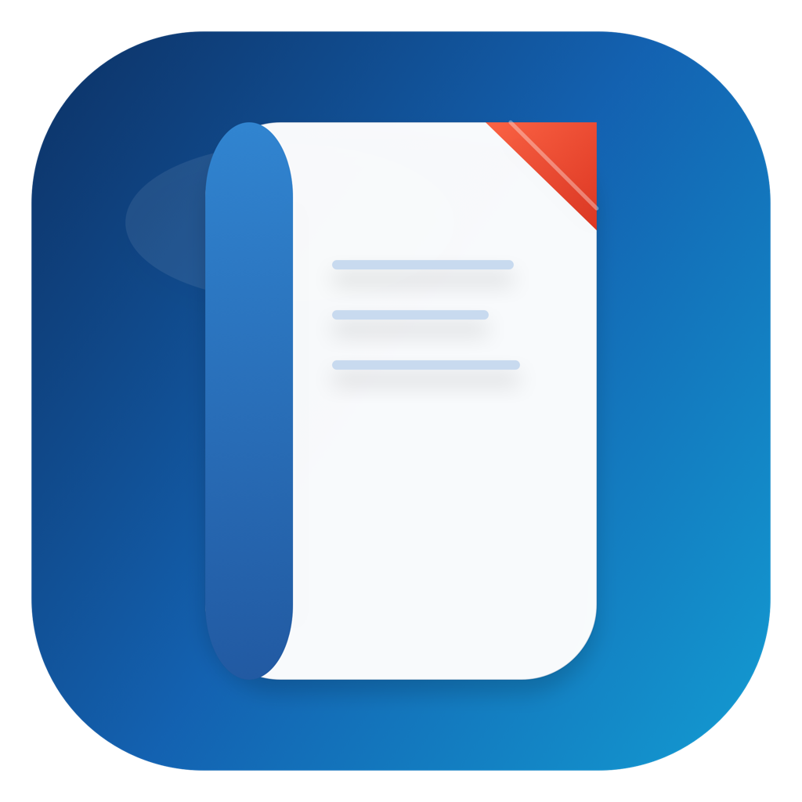
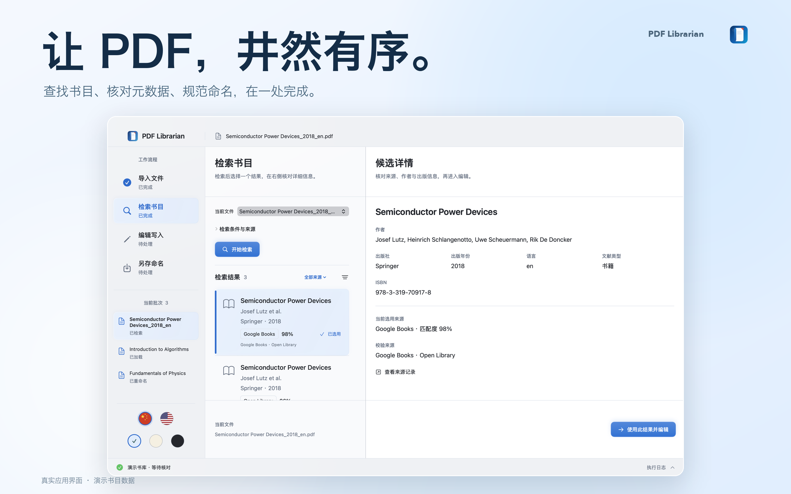
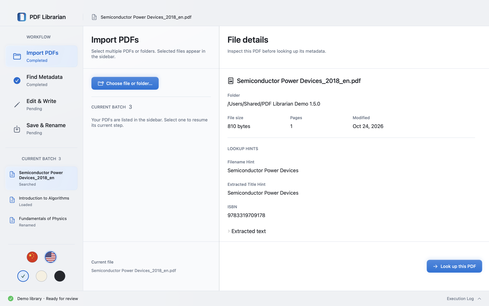

<p align="center"></p>
<h1 align="center">PDF Librarian</h1>
<p align="center"><strong>1.5.0 · Build 2 · macOS 13+</strong></p>
<p align="center">让每份 PDF，都有清楚的来处。<br>A proper place for every PDF.</p>
<p align="center"><a href="https://larryhu.com/PDFLibrarian/">主页 / Website</a> · <a href="https://apps.apple.com/app/id6760351540">Mac App Store</a> · <a href="https://github.com/LarryHu1988/PDFLibrarian/releases/latest">Releases</a> · <a href="https://larryhu.com/PDFLibrarian/support/">Support</a></p>



PDF Librarian 是一款原生 macOS PDF 书目整理工具。围绕四步流程，在三栏工作区中导入 PDF、检索候选书目、核对并写入元数据，再以清晰的文件名保存。

| 流程 | 你可以做什么 |
| --- | --- |
| 导入文件 | 多选 PDF 或文件夹，从侧栏查看每个文件的状态并继续处理。 |
| 检索书目 | 从文件名和可提取文本识别标题、ISBN、DOI 等线索，查询并比较公开书目记录。 |
| 编辑写入 | 编辑 12 项 Dublin Core 字段；写入前对比 PDF 当前值和拟写入值，明确标出修改和清空项。 |
| 另存命名 | 按标题、作者、出版社、年份、语言预览建议文件名；五种对应颜色帮助核对，名称可手动调整。 |

固定流程侧栏，中栏与详情栏可拖动调宽。提供蓝白、暖绿、深色三种主题，以及简体中文和英文两种界面。内置 ExifTool 及必需模块，无需另行安装。

PDF 保留在本机。主动联网检索时，应用向所选公开来源发送书目查询线索，不上传完整 PDF。无需账户，无广告、跟踪或分析 SDK。公开来源的完整度和可用性可能不同。写入会替换元数据，确认框会列出变化；重要资料建议先保留副本。

需要 macOS 13 或以上版本，支持 Apple 芯片和 Intel Mac。可在 [GitHub 1.5.0 发布页](https://github.com/LarryHu1988/PDFLibrarian/releases/tag/V1.5.0)下载已通过 Apple 公证的直装 ZIP。Mac App Store 的 1.5.0（构建 2）已准备至 Connect，尚未提交审核。

### English

PDF Librarian is a native macOS workspace for organizing the metadata and filenames of book and research PDFs.



| Workflow | What you can do |
| --- | --- |
| Import PDFs | Select multiple PDFs or folders. Track and resume each file from the sidebar. |
| Find Metadata | Use clues from filenames and selectable PDF text to compare public catalog records. |
| Edit & Write | Edit 12 Dublin Core fields. Compare current PDF values with proposed changes, including cleared fields, before writing. |
| Save & Rename | Preview an editable filename with matching colors for title, author, publisher, year, and language. |

A fixed workflow sidebar and adjustable content/detail panes keep context in view. Choose blue, warm sage, or dark appearance. The interface is available in Simplified Chinese and English. ExifTool and its required modules are included.

Your PDFs stay on your Mac. Requested online searches send bibliographic clues to the selected public sources, not entire PDFs. No account, ads, tracking, or analytics SDKs. Public catalogs vary in coverage and availability. Metadata is replaced only after confirmation; keep copies of important documents.

Requires macOS 13 or later. Universal builds support Apple silicon and Intel Macs. Download the Apple-notarized direct-install ZIP from the [GitHub 1.5.0 release](https://github.com/LarryHu1988/PDFLibrarian/releases/tag/V1.5.0). Mac App Store version 1.5.0 (build 2) is prepared in Connect and has not been submitted for review.

### Development

Open `PDFLibrarian.xcodeproj` in full Xcode and select the `PDFLibrarian` scheme. `project.yml` is the XcodeGen source. Version values must match `Sources/PDFLibrarian/Info.plist`. Store signing assets outside the repository.

```sh
export DEVELOPER_DIR=/Applications/Xcode.app/Contents/Developer
xcodebuild -project PDFLibrarian.xcodeproj -scheme PDFLibrarian -configuration Release -destination 'generic/platform=macOS' ARCHS='arm64 x86_64' ONLY_ACTIVE_ARCH=NO CODE_SIGNING_ALLOWED=NO build
scripts/test_workspace_ui.sh dist/1.5.0/qa
scripts/capture_release.sh dist/1.5.0/captures
```

`vendor/exiftool` contains the upstream source archive and license notices. The build script bundles the complete required runtime. Tests cover sandboxed writes, current PDF metadata reads, changed/cleared-field previews, Unicode, large values, invalid PDFs, and document-body preservation.

### Links & license

[Privacy policy](https://larryhu.com/PDFLibrarian/privacy-policy/) · [Support](https://larryhu.com/PDFLibrarian/support/) · [Report an issue](https://github.com/LarryHu1988/PDFLibrarian/issues)

Copyright © 2026 Larry Hu. See [LICENSE](LICENSE). Third-party components retain their own licenses; see `vendor/exiftool/NOTICE.txt`.
